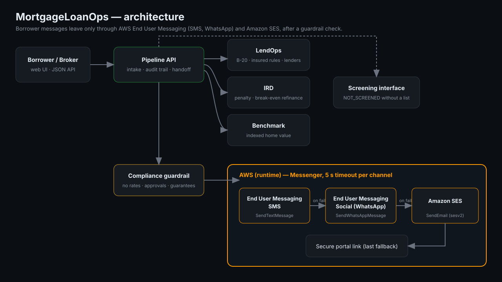

# Architecture



```
Borrower / broker ── HTTPS ──> MortgageLoanOps API (stdlib server or any Lambda/ECS/EC2 host)
                                   │
        ┌──────────────────────────┼───────────────────────────┐
        ▼                          ▼                           ▼
   Qualification              Renewal / IRD               Home value
   B-20 stress, GDS/TDS       3-mo vs IRD, break-even     regional index
   insured rules, lenders     refinance analysis          (Benchmark)
        └──────────────┬───────────┴───────────────┬───────────┘
                       ▼                           ▼
                 Screening interface        Compliance guardrail
                 (NOT_SCREENED w/o list)    (no rates / approvals / guarantees)
                                   │ allowed message only
                                   ▼
        ┌─────────── Messenger: 5 s timeout per channel ───────────┐
        │ AWS End User Messaging SMS  → AWS End User Messaging     │
        │ (pinpoint-sms-voice-v2        Social / WhatsApp           │
        │  SendTextMessage)             (socialmessaging           │
        │                                SendWhatsAppMessage)      │
        │                         → Amazon SES (sesv2 SendEmail)   │
        │                         → secure portal link             │
        └───────────────────────────────────────────────────────────┘
```

## AWS services used at runtime
| Service | API call | Where |
|---|---|---|
| AWS End User Messaging RCS | `pinpoint-sms-voice-v2` `SendTextMessage` with an RCS agent ARN as `OriginationIdentity` | `messaging.py::Messenger._send("rcs")` (only when `MLO_RCS_AGENT_ARN` is set) |
| AWS End User Messaging SMS | `pinpoint-sms-voice-v2` `SendTextMessage` | `messaging.py::Messenger._send("sms")` |
| AWS End User Messaging Social (WhatsApp) | `socialmessaging` `SendWhatsAppMessage` | `messaging.py::Messenger._send("whatsapp")` |
| Amazon SES | `sesv2` `SendEmail` | `messaging.py::Messenger._send("email")` |

Request payloads are built by `build_rcs`, `build_sms`, `build_whatsapp` and `build_email` and are asserted field by field in `tests/test_aws_messaging.py`.

## Design decisions
- **Guardrail before channel**: a blocked message never reaches any AWS API (tested).
- **Honest screening**: no data bundled, so the module cannot report "clear".
- **Dry-run default**: judges and developers can run everything without credentials; switch to live with `MLO_LIVE=1`.
- **Zero runtime dependencies** besides boto3 in live mode.
